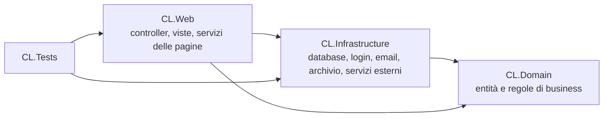

# Architettura

Come è organizzato il codice e come passa una richiesta dal browser al database.
Per avviare il progetto vedi [sviluppo.md](sviluppo.md); per cosa fa l'applicazione vedi [funzionalita.md](funzionalita.md).

## I progetti

| Progetto | Contiene | Dipende da |
|---|---|---|
| `src/CL.Domain` | Entità, value object e regole (saldi, calendario, contratti…). Nessuna libreria esterna: si testa senza database. | — |
| `src/CL.Infrastructure` | EF Core (PostgreSQL/SQLite), ASP.NET Identity, coda email, archivio file, VIES e ricerca indirizzi. | Domain |
| `src/CL.Web` | ASP.NET Core MVC: controller, viste Razor, servizi che preparano i dati delle pagine, file statici. | Infrastructure, Domain |
| `tests/CL.Tests` | Test xUnit del dominio, della persistenza e dell'app web completa. | Web, Infrastructure |

Non c'è uno strato "Application" separato: i casi d'uso stanno nei controller e nei servizi di `CL.Web/Infrastruttura`,
che usano direttamente `AppDbContext` e le entità del dominio.

## Il percorso di una richiesta

`src/CL.Web/Program.cs`, in ordine:

1. **Lingua**: cultura `it-IT` per date, numeri e messaggi.
2. **Database**: all'avvio `DatabaseInitializer` prepara lo schema (migrazioni solo in Development, `EnsureCreated` su
   SQLite), crea i ruoli e gli utenti iniziali da `Seed:*`.
3. **Errori**: fuori da Development `UseExceptionHandler("/Home/Error")`, HSTS e redirect HTTPS.
4. **Autenticazione**: cookie `cl.auth` di 8 ore con scadenza mobile (si rinnova mentre l'utente lavora).
5. **Perimetro aziende**: per un consulente che non è super amministratore, un middleware legge le aziende a lui assegnate
   (`AssegnazioniAziende`) e le mette in `PerimetroAziende`. Da quel momento i filtri globali di `AppDbContext`
   nascondono tutto il resto in **ogni** query.
6. **Autorizzazione**: un filtro MVC globale richiede il login ovunque (salvo `[AllowAnonymous]`). Le politiche sono
   `SoloConsulente` (studio) e `GestionePersonale` (studio o referente azienda).
7. **Onboarding**: `FiltroOnboarding` rimanda al percorso guidato il referente la cui azienda non ha completato il profilo
   e il dipendente che non ha completato i propri dati. Restano aperti solo il percorso, l'account e la ricerca
   indirizzi (che serve ai passi delle sedi e della residenza).
8. **Controller**: rotta standard `{controller=Home}/{action=Index}/{id?}`.

## Ruoli e perimetro dei dati

| Ruolo | Cosa vede | Da dove viene il limite |
|---|---|---|
| Super amministratore (`Amministratore`) | Tutto. Crea i consulenti e assegna loro le aziende. Ha anche il ruolo `Consulente`. | Nessun limite. |
| Consulente | Solo le aziende assegnate (quelle che crea gli vengono assegnate subito). | Filtri globali di `AppDbContext` riempiti dal middleware. |
| Referente azienda (`Azienda`) | Solo la propria azienda. | Claim `cl:azienda_id`, controllato nei controller. |
| Dipendente | Solo sé stesso. | Claim `cl:dipendente_id`, controllato nei controller. |

`UtenteCorrente` (in `CL.Web/Infrastruttura`) legge i claim del cookie ed è il modo standard per sapere chi sta usando
l'app (`IsConsulente`, `IsAzienda`, `AziendaId`, `DipendenteId`…). I claim sono creati da `ClaimsFactory`.

### Filtri globali (`AppDbContext`)

- Le entità con `AziendaId` (aziende, dipendenti, buste paga, CU, chiusure, presenze, profili, team) sono filtrate
  direttamente sulle aziende consentite.
- I dati della persona senza `AziendaId` (contratti, richieste, saldi…) sono visibili se è visibile il dipendente:
  la sottoquery sui dipendenti ha a sua volta il filtro per azienda.
- Con `Consentite = null` (super amministratore, referente, dipendente, test) non c'è nessun filtro.
- Le poche query che devono vedere tutto (es. "questa partita IVA esiste già?") usano `IgnoreQueryFilters()`.

## Dominio (`CL.Domain`)

Tutte le entità derivano da `Common/Entity` (Id `Guid` generato nel dominio). Le regole violate lanciano
`DomainException` con un messaggio pensato per l'utente; i controlli ricorrenti sono in `Guard`.

| Cartella | Contenuto |
|---|---|
| `ValueObjects` | `CodiceFiscale` (omocodia e carattere di controllo), `PartitaIva` (Luhn), `Iban` (mod-97), `Comuni`/`Province` dall'elenco ISTAT incorporato (`comuni.csv`). Salvati come testo e rivalidati in lettura. |
| `Aziende` | `Azienda` (anagrafica, logo, tipi di richiesta disattivati), `TipiRichiesta` (catalogo: ferie e malattia sempre attivi), `ProfiloAzienda` (percorso guidato in 6 passi). |
| `Dipendenti` | `Dipendente` (anagrafica, residenza, IBAN, team, responsabile, genere e pronomi), `Contratto` (subordinati ed esterni, part-time, spettanze, modalità di lavoro, smart working concesso), `ProfiloDipendente` (dati per le paghe in 6 passi). |
| `Assenze` | `CalendarioLavorativo` (festività, Pasqua, santo patrono), `PianificatoreAssenze` (crea richieste valide con le ore già calcolate), `RichiestaAssenza` (stati e cancellazione), `CalcoloSaldi`, `ChiusuraAziendale`. |
| `Presenze` | `ComunicazioneMensile` (foglio presenze del mese: Bozza → Inviata → Elaborata), `GiornoInUfficio`, `GiornoSmartWorking`, `Straordinario`. |
| `BustePaga`, `Documenti` | `BustaPaga` (Bozza → Pubblicata → Ritirata, hash SHA-256 unico, presa visione), `CertificazioneUnica`. |
| `Organizzazione` | `Team` (albero senza cicli, colore ed emoji) e `Organigramma` (chi approva le richieste di chi). |
| `Notifiche` | `CatalogoNotifiche` (tipologie, sezioni e destinatari), `Notifica` (in piattaforma, per utente), `PreferenzaNotifica` (email accesa o spenta per tipologia). |

### Regole principali

- **Ore, non giorni**: una richiesta salva le ore già calcolate sui giorni lavorativi del contratto
  (giorni × orario giornaliero, oppure le ore di un permesso). Così un saldo non cambia se il calendario cambia dopo.
- **Maturazione**: per ferie e ROL si matura 1/12 della spettanza annua per ogni mese in cui i contratti della persona
  coprono almeno 15 giorni; vale la spettanza del contratto con più giorni nel mese.
- **Saldo**: residuo = residuo dell'anno precedente + maturato − approvate; disponibile = residuo − in attesa.
- **Niente richieste a cavallo d'anno**, niente sovrapposizioni (tranne più permessi a ore entro l'orario giornaliero),
  contratto attivo per tutto il periodo. La malattia non richiede approvazione.
- **Approvatore** (`Organigramma`): il responsabile diretto; altrimenti il responsabile del team, risalendo ai team
  superiori se è la persona stessa; altrimenti il referente dell'azienda.

## Persistenza (`CL.Infrastructure/Persistence`)

- `AppDbContext` è un `IdentityDbContext`: entità di dominio e tabelle di Identity stanno nello stesso schema **`hr`**.
- `Configurations.cs` contiene il mapping di tutte le entità. Gli Id sono `ValueGeneratedNever` (nascono nel dominio);
  tra entità diverse ci sono solo chiavi esterne, senza proprietà di navigazione; le collezioni interne di un'entità
  (contratti, righe presenze, familiari) si caricano sempre (`AutoInclude`).
- Convenzioni: decimali con 2 cifre, enum salvati come testo (leggibili e indipendenti dall'ordine dei valori).
- PostgreSQL via Npgsql con nuovi tentativi automatici sugli errori di rete; SQLite per la demo e i test.
- Le migrazioni sono in `Persistence/Migrations`, con lo script idempotente `schema.sql` per la produzione.

## Login e utenti (`CL.Infrastructure/Identity`)

- `ApplicationUser` aggiunge a Identity: nome, cognome, `AziendaId`, `DipendenteId`, `Attivo`.
- Password di almeno 10 caratteri; blocco di 15 minuti dopo 5 tentativi falliti.
- Link di invito e di recupero password validi 3 giorni; un utente disattivato o con password cambiata perde le sessioni
  aperte entro 5 minuti.

## Email (`CL.Infrastructure/Email`)

Le pagine non aspettano il server SMTP: mettono il messaggio in `CodaEmail` (un canale in memoria) e il servizio in
background `InvioCodaEmail` lo spedisce. Se l'app si ferma, i messaggi ancora in coda si perdono. Senza `Email:Host` e
`Email:Mittente` l'invio è disattivato e i link di invito vengono mostrati a schermo.

## Notifiche

Gli avvisi passano tutti da `ServizioNotifiche.InviaAsync`: salva una `Notifica` per ogni destinatario (tabella
`Notifiche`, sempre) e accoda l'email a chi non l'ha spenta per quella tipologia (tabella `PreferenzeNotifiche`, una riga
solo quando l'utente cambia la scelta). Esclude chi compie l'azione; con una `Chiave` non ripete un promemoria già
ricevuto. I destinatari si trovano con le query di `QueryDestinatari` (studio, referenti, persone, utenti) e devono avere
l'accesso attivo; l'email parte solo con l'email confermata. I testi delle richieste sono in `NotificheRichieste`; gli altri
eventi chiamano il servizio dal proprio controller o servizio. Le scadenze le controlla `PromemoriaScadenze`, lanciato dal
servizio in background `ControlloScadenze` (non registrato nell'ambiente `Testing`, dove i test lo chiamano a mano).
WhatsApp è il secondo canale di `PreferenzaNotifica` (predefinito spento): `InviaAsync` accoda in `CodaWhatsApp` le
notifiche per chi ha collegato il numero (`PhoneNumber` confermato e `WhatsAppConsensoIl` dell'utente) e le ha accese;
`InvioCodaWhatsApp` le spedisce con `IInvioWhatsApp` (`CL.Infrastructure/WhatsApp`, WhatsApp Cloud API con template).
Il collegamento lo gestisce `CollegamentoWhatsApp`: il codice è il token telefonico di Identity
(`GenerateChangePhoneNumberTokenAsync`), con attesa tra un invio e l'altro e tentativi limitati in memoria.

## Archivio documenti (`CL.Infrastructure/Archivio`)

`IArchivioDocumenti` salva buste paga, CU, contratti, foto e loghi su disco in `Archivio:Percorso`, fuori da `wwwroot`:
i file si scaricano solo passando dai controller, che controllano i permessi. Le chiavi dei file sono generate dall'app
e validate (solo pdf, png, jpg, webp; niente `..`); la scrittura passa da un file temporaneo poi rinominato.

## Servizi esterni

| Servizio | Classe | A cosa serve |
|---|---|---|
| VIES (Commissione europea) | `Registro/RicercaVies` | Dalla partita IVA: ragione sociale e sede, con maiuscole normalizzate. |
| Photon (OpenStreetMap) | `Indirizzi/RicercaPhoton` | Suggerimenti di indirizzo, solo Italia, con comune e provincia riportati ai nomi ISTAT. Chiamato dal server: IP e cookie dell'utente non escono. |

Nei test entrambi sono sostituiti da implementazioni finte (`AppFactory`).

## L'app web (`CL.Web`)

| Cartella | Contenuto |
|---|---|
| `Controllers` | Un controller per sezione. I form (view model) sono definiti nello stesso file del controller che li usa. |
| `Infrastruttura` | Servizi condivisi tra le pagine (vedi sotto), `AppController` (base dei controller), filtri e query riusabili. |
| `Views` | Viste Razor; le partial iniziano con `_`. `Shared/_Layout.cshtml` contiene sidebar, barra in alto e menù per ruolo. |
| `wwwroot` | `assets/` (CSS, font e plugin copiati da ConsulensNew), `css/site.css` (stili di questo progetto), `js/` (script delle pagine), `lib/` (jQuery, Bootstrap, ApexCharts). |

Servizi principali in `Infrastruttura`:

| Servizio | Ruolo |
|---|---|
| `UtenteCorrente` | Chi è l'utente e cosa può vedere (dai claim). |
| `AppController` | `Prova(...)` esegue un'operazione di dominio e mostra la regola violata nel form; `ProvaOAvvisa(...)` la mostra come messaggio dopo un redirect; `Conferma`/`Errore` per i messaggi. |
| `ServizioAccessi` | Inviti, link per impostare la password, attivazione e disattivazione degli accessi, elenco utenti. |
| `ServizioConsulentiAziende` | Assegnazione delle aziende ai consulenti e filtro per consulente nelle liste. |
| `ServizioOrganigramma` | Team, approvatori e collaboratori a partire dal database. |
| `ServizioSaldi` | Carica richieste e residui e calcola i saldi con le regole del dominio. |
| `ServizioUfficio` | Modalità di lavoro, giorni in ufficio e smart working della persona. |
| `ServizioPresenze` | Foglio presenze del mese: righe per i dipendenti in forza, invio, esportazione CSV. |
| `ServizioPanoramica` | Dati della home di consulente e referente (da fare, indicatori, grafici, scadenze). |
| `ServizioBustePaga` | Caricamento dei PDF dei cedolini, abbinamento alle persone, pubblicazione. |
| `ServizioNotifiche` | Consegna delle notifiche (piattaforma ed email), campanella, letture e impostazioni dell'utente. |
| `NotificheRichieste` | Testi e destinatari delle notifiche su assenze, smart working, straordinari, cambi turno e chiusure. |
| `PromemoriaScadenze` | Promemoria di contratti e documenti personali in scadenza (una volta per scadenza). |
| `EliminazioneAzienda` | Eliminazione definitiva di un'azienda disattivata con tutti i dati, in una transazione; poi i file dell'archivio. |
| `Immagini`, `LoghiAziende`, `FotoDipendenti`, `ServizioAvatar` | Caricamento e visualizzazione di loghi e foto. |
| `Filtri`, `Elenchi` | Condizioni riusabili tradotte in SQL; opzioni delle select di indirizzo. |
